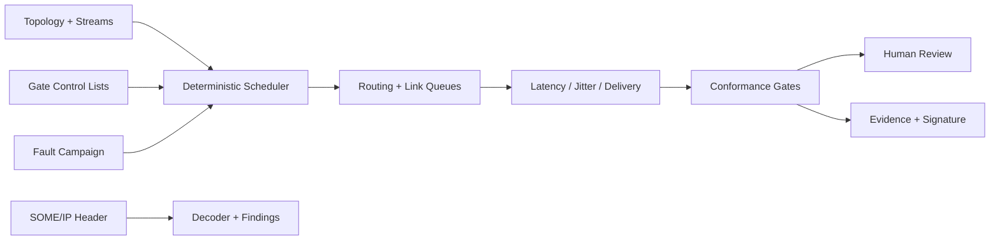

# AutoEther TSN Lab

A deterministic Automotive Ethernet and Time-Sensitive Networking validation laboratory. It models endpoints, directed links, VLAN-tagged periodic streams, strict-priority schedules, time-aware gates, timing faults and evidence-based conformance gates.

> This is a host simulation and analysis tool, not a production Ethernet/TSN or SOME/IP stack and not evidence of standards certification.

## Implemented

- bounded nodes, directed links and periodic traffic streams
- link speed, propagation delay, payload, VLAN, priority, period and deadline models
- automatic shortest-hop routing or explicit per-stream routes
- IEEE 802.1Qbv-style cyclic gate windows by priority
- deterministic serialization, link contention and gate waiting
- latency mean/P95/maximum, jitter P95, delivery ratio, deadline misses and duplicates
- per-link frames, bytes, busy time and drops
- deterministic link-down, packet-loss, latency, bandwidth and duplicate faults
- configurable per-stream/wildcard conformance gates
- baseline/candidate comparison
- SOME/IP 16-byte base-header decoder and basic structural validation
- SHA-256 evidence integrity and optional RSA-SHA256 evidence signatures
- bounded loopback REST API, optional bearer authentication and browser dashboard
- zonal-controller TSN demonstration
- **31 dependency-free runtime tests**

## Quick start

Requires Node.js 20 or later.

```bash
npm test
npm run demo
npm start
```

Open <http://127.0.0.1:8083>. Set `API_TOKEN` from a secret manager to require bearer authentication.

## API

| Method | Path | Purpose |
|---|---|---|
| GET | `/api/health` | Runtime health |
| GET | `/api/example` | Topology, fault scenario and policy |
| POST | `/api/simulations` | Run deterministic network campaign |
| GET | `/api/simulations/{id}` | Retrieve report and frame trace |
| GET | `/api/simulations/{id}/evidence` | Retrieve evidence envelope |
| POST | `/api/evidence/verify` | Verify integrity |
| POST | `/api/compare` | Compare two runs |
| POST | `/api/someip/decode` | Decode a hexadecimal SOME/IP base header |

Bodies are limited to **3,000,000 bytes**, scenarios to **60,000,000 μs**, topologies to **1,000 nodes**, **5,000 links**, **10,000 streams**, and retained runs to **100**.

## Architecture



See [architecture](docs/architecture.md), [timing semantics](docs/timing-semantics.md), and [threat model](docs/threat-model.md).

## Honest scope

No real packet I/O, Linux TAP, PCAP, gPTP, 802.1AS clock servo, 802.1Qav credit-based shaping, 802.1Qbu frame preemption, 802.1CB redundancy, full SOME/IP/SD, AUTOSAR, switch hardware, HIL, or interoperability certification is implemented. These belong in target adapters and test rigs.

## Security, safety and licensing

The service binds to loopback, validates bounded inputs, emits restrictive browser headers, and supports bearer authentication. It does not configure vehicle networks. See [SECURITY.md](SECURITY.md).

This version is proprietary and source-available. Production, commercial, customer, vehicle, embedded-system or field use requires a separate written commercial license. See [LICENSE](LICENSE) or contact `nagaraj.rbhagwat@expleogroup.com` or an authorized Expleo Group representative. The initial historical MIT commit retains its prior grant.
